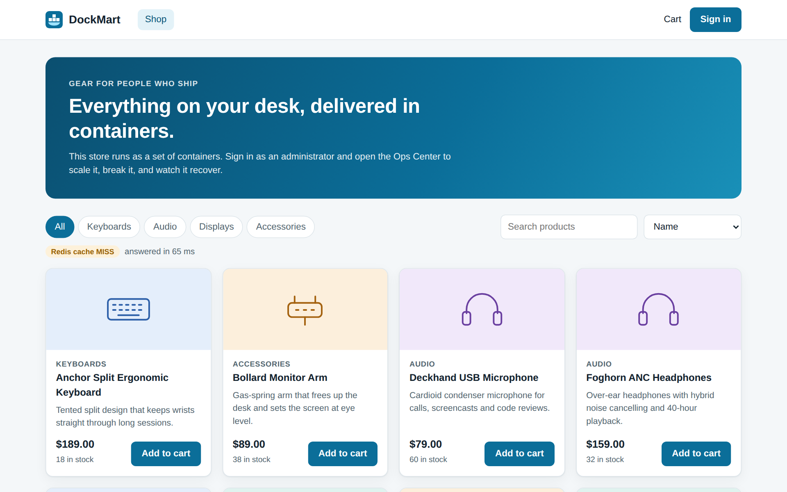
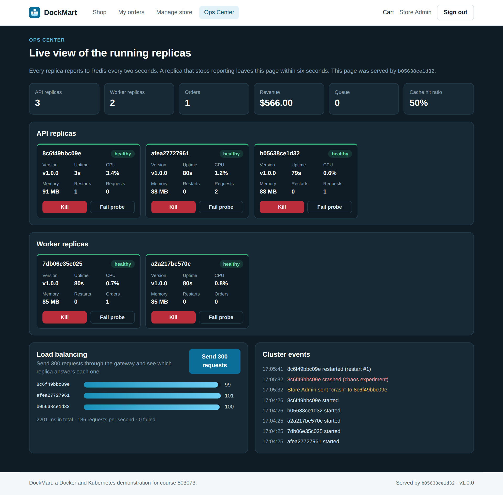

# DockMart: containers in web development and deployment

A multi-container online store built with Node.js and React. The store itself is ordinary. The point is how it runs:
scale it while it serves traffic, kill containers and watch them recover, and run the same images on Docker Compose
and on a three-node Kubernetes cluster.

This is the midterm essay for course 503073 Web Programming & Applications at Ton Duc Thang University. The repository
holds the demo, the report and the presentation.

| Storefront | Ops Center, just after one replica crashed |
|---|---|
|  |  |

## Quick start

Docker is the only requirement. Node.js, PostgreSQL and Redis all run in containers.

```bash
git clone https://github.com/TTHieu1406/Web_Midterm.git
cd Web_Midterm/source
docker compose up -d --build --wait
```

The first run takes a few minutes. Then open <http://localhost:8080> and sign in with `admin@dockmart.local` and
`DockMart-Admin-2026` to reach the **Ops Center**. These are demo values, and customers can register on the sign-in page.

```bash
docker compose --profile test run --rm smoke    # run the 24 end-to-end tests
docker compose down -v                          # stop and delete all data
```

The [full guide](source/README.md) covers scaling, failure scenarios, monitoring, development mode and Kubernetes.

## What was measured

| Experiment | Result |
|---|---|
| Image size, naive Dockerfile to multi-stage build | 1,718 MB to 288 MB |
| Critical vulnerabilities in the image | 57 to 0 |
| Throughput from one to six API replicas | 107 to 510 requests per second (4.8 times) |
| Process crash at 100 requests per second | 0 of 4,001 requests failed, recovered in 6.6 s |
| Rolling update on Kubernetes at 100 requests per second | 0 of 7,500 requests failed, finished in 14.2 s |
| Autoscaling on Kubernetes | 3 to 8 replicas in about 60 s, then back to 3 by itself |
| Redis outage | Catalog still answers in 28 ms, and checkout refuses with a clear message |

All tests ran on one computer, so read these as comparisons and not as production capacity. Chapter 4 of the
[report](report/503073_Midterm_Report_Docker.pdf) gives the method and the limits, and the raw data is in
[source/results](source/results).

## Architecture


The browser reaches the system only through the gateway. API replicas keep no state in memory, so any replica can serve
any request. Orders go through a Redis queue to worker containers, and the databases sit on an internal network that the
gateway cannot reach.

**Stack:** React, Node.js, Express, PostgreSQL, Redis, BullMQ, Nginx, Docker Compose, Kubernetes, Prometheus, Grafana.

## Repository

| Folder | Content |
|---|---|
| [source](source) | DockMart: code, Compose files, Kubernetes manifests, tests and measurements |
| [report](report) | Report and slides, in Word, PowerPoint and PDF |
| [video](video) | Scripts for the presentation video |
| [docs](docs) | Assignment brief and faculty templates |

## Team

Trần Trung Hiếu (52400047) and Nguyễn Đức Nhật Huy (52400122). Instructor: MSc. Nguyễn Thái Duy.
