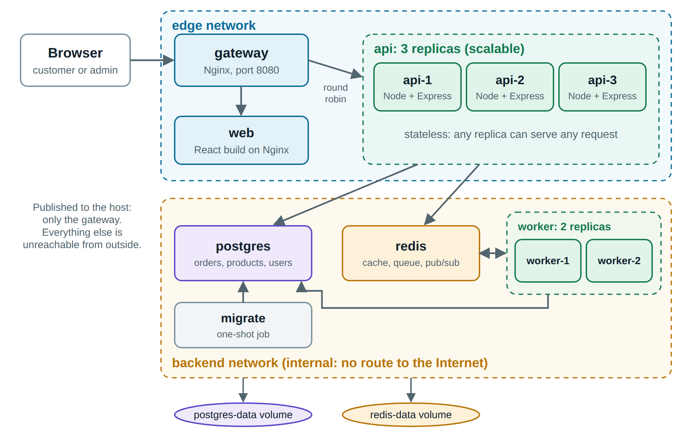

# DockMart

Demonstration project for the midterm essay **"Containers in Web Development and Deployment (Docker)"**,
course 503073 Web Programming & Applications, Semester 1, 2026-2027, Ton Duc Thang University.

| Team member | Student ID |
|---|---|
| Trần Trung Hiếu | 52400047 |
| Nguyễn Đức Nhật Huy | 52400122 |

Instructor: MSc. Nguyễn Thái Duy

DockMart is a small online store split into containers. The store itself is ordinary. The point of the project is
how it runs: replicas you can scale while it serves traffic, a live **Ops Center** where you can kill containers and
watch them recover, and the same images running unchanged on Docker Compose and on a three-node Kubernetes cluster.



## 1. System requirements

| Requirement | Version used for testing | Notes |
|---|---|---|
| OS | Windows 11 with WSL 2 | Any OS that runs Docker works |
| Docker Desktop, or Docker Engine + Compose plugin | Docker 29.8, Compose 5.5 | Compose 2.24 or later is needed |
| Free memory | 8 GB assigned to Docker | 2 GB is enough without Kubernetes and monitoring |
| Free ports | 8080, plus 3000 and 9090 for monitoring | Change 8080 with `HTTP_PORT` in `.env` |

**Docker is the only requirement.** Node.js, PostgreSQL and Redis all run in containers, so nothing else needs to be
installed. The `.sh` and `.py` helper scripts in sections 6 and 7 are optional. They need Git Bash and Python.

## 2. Quick start

Run these from this folder (the one containing `compose.yaml`):

```bash
docker compose up -d --build --wait
```

The first run downloads the base images and takes a few minutes. Then open <http://localhost:8080>.

To check that everything works, run the automated end-to-end tests (24 checks, about 15 seconds):

```bash
docker compose --profile test run --rm smoke
```

## 3. Accounts

| Role | Email | Password |
|---|---|---|
| Administrator (Manage store, Ops Center) | `admin@dockmart.local` | `DockMart-Admin-2026` |
| Customer | Use **Create an account** on the sign-in page | Your choice, at least 8 characters |
| Grafana (read-only needs no login) | `admin` | `DockMart-Admin-2026` |

The files in `secrets/` hold **demo values** so that the project starts with one command. A real deployment would
generate its own values and never commit them.

## 4. Project structure

```text
backend/       API, worker and migrator: one image, three commands
web/           React storefront and Ops Center, served by an unprivileged Nginx
gateway/       Nginx reverse proxy: load balancing, rate limiting, security headers
compose.yaml   Production-like stack
compose.dev.yaml  Development overrides with live code sync
k8s/           Kubernetes manifests
monitoring/    Prometheus and Grafana configuration
tests/         End-to-end tests (smoke) and load tests (k6)
experiments/   Alternative Dockerfiles compared in the report
scripts/       Scripts that produced the measurements in the report
results/       Raw measurement data
secrets/       Demo-only secrets
```

## 5. Demonstration walkthrough (Docker Compose)

### Shop

1. Open <http://localhost:8080>, create an account and add products to the cart.
2. Place an order. On **My orders** the status moves from *Queued* to *Shipped* without a page reload. A worker
   container does this in the background, and the footer of each order shows which one.
3. Reload the shop page. The note above the products shows `Redis cache HIT` or `MISS`.

### Ops Center

Sign in as the administrator and open **Ops Center**. It shows every running replica, its version, CPU, memory and
restart count.

| Try this | What happens |
|---|---|
| **Send 300 requests** | The bars show the gateway spreading requests evenly across replicas |
| **Kill** on an API replica | The process crashes and Docker restarts it within seconds. Its `Uptime` returns to zero, `Restarts` rises by one, and the site keeps answering |
| **Kill** on a worker while an order is being processed | The job is picked up again, and the order still ships. Its stages are not repeated |

> Use the **Kill** button, not `docker kill`. Docker treats `docker kill` and `docker stop` as a decision by the
> operator, so the restart policy deliberately does not bring those containers back.

### Scaling

Keep the Ops Center open and run:

```bash
docker compose up -d --scale api=5 --no-recreate
```

Two cards appear within seconds, and the gateway uses them without being restarted. Scale back with `--scale api=3`.

### Persistence

```bash
docker compose rm -sf postgres        # delete the database container
docker compose up -d postgres         # create a new one
```

Products and orders are still there, because they live in the `postgres-data` volume and not in the container.

### Network isolation and hardening

```bash
# The gateway has no route to the database network: both commands fail with "bad address"
docker compose exec gateway nc -z -w2 postgres 5432
docker compose exec gateway nc -z -w2 redis 6379

# The API runs as an unprivileged user, on a read-only filesystem, with no capabilities
docker compose exec api sh -c 'id; touch /app/x; grep CapEff /proc/1/status'
```

### Monitoring

```bash
docker compose --profile monitoring up -d
```

Open Grafana at <http://localhost:3000> (dashboard **DockMart**) and Prometheus at <http://localhost:9090>. The first
start of Grafana can take up to a minute. Replicas are discovered through DNS, so scaling needs no configuration change.

### Development with live code sync

```bash
docker compose down
docker compose -f compose.yaml -f compose.dev.yaml up -d --build
docker compose -f compose.yaml -f compose.dev.yaml watch
```

Edit a file in `backend/src` or `web/src` and the change is live in a moment. No Node.js is needed on the host.
Press `Ctrl+C` to stop watching, then run `docker compose -f compose.yaml -f compose.dev.yaml down`.

### Tests

```bash
docker build --target test backend     # lint and unit tests, inside the build
docker build --target test web
docker compose --profile test run --rm smoke
```

## 6. Kubernetes

Tested on the Kubernetes cluster built into Docker Desktop:
**Settings → Kubernetes → Enable Kubernetes**, with **Cluster provisioning: kind** and **Node count: 3**.

Run these from this folder, in Git Bash on Windows:

```bash
# Build the images, including version 1.1.0 for the rolling update
docker compose build
docker build --target production --build-arg APP_VERSION=1.1.0 -t dockmart/backend:1.1.0 backend

# Copy them into the cluster nodes
bash k8s/load-images.sh

# Create the namespace and the Secret, then deploy
kubectl create namespace dockmart
kubectl -n dockmart create secret generic dockmart-secrets \
  --from-file=db_password=secrets/db_password.txt \
  --from-file=redis_password=secrets/redis_password.txt \
  --from-file=jwt_secret=secrets/jwt_secret.txt \
  --from-file=admin_password=secrets/admin_password.txt
kubectl apply -k k8s/base

# Wait, then open the site at http://localhost:8088
kubectl -n dockmart wait --for=condition=complete job/migrate --timeout=180s
kubectl -n dockmart rollout status deploy/api
kubectl -n dockmart port-forward svc/gateway 8088:8080
```

In another terminal:

```bash
kubectl -n dockmart get pods -o wide                                   # replicas spread across nodes

kubectl -n dockmart set image deploy/api api=dockmart/backend:1.1.0    # rolling update
kubectl -n dockmart rollout status deploy/api
kubectl -n dockmart rollout undo deploy/api                            # rollback

kubectl -n dockmart delete $(kubectl -n dockmart get pod -l app=api -o name | head -1)   # self-healing
kubectl -n dockmart get pods -l app=api                                # a replacement is already starting
```

Run the end-to-end tests inside the cluster:

```bash
kubectl -n dockmart create configmap smoke-tests --from-file=tests/smoke/smoke.test.mjs
kubectl apply -f k8s/test-jobs/smoke.yaml
kubectl -n dockmart wait --for=condition=complete job/smoke --timeout=120s
kubectl -n dockmart logs job/smoke --tail 12
```

### Autoscaling (HorizontalPodAutoscaler)

The HPA needs metrics-server, which is included as `k8s/metrics-server.yaml`:

```bash
kubectl apply -f k8s/metrics-server.yaml
kubectl -n dockmart get hpa --watch
```

Remove everything with `kubectl delete namespace dockmart`, and switch Kubernetes off in Docker Desktop to free memory.

## 7. Reproducing the measurements

```bash
# Docker Compose: images, start-up, scaling, failures, network paths
python scripts/measure_compose.py all

# Kubernetes availability and autoscaling. Needs the deployment from section 6 and metrics-server.
kubectl -n dockmart create configmap load-tests --from-file=tests/load/
python scripts/k8s_experiments.py
```

Results are written to `results/`. The Compose scripts stop and restart the stack, so run them on their own, and
turn off anything else that uses the CPU if you want comparable numbers.

## 8. Troubleshooting

| Problem | Fix |
|---|---|
| `port is already allocated` on 8080 | Copy `.env.example` to `.env` and change `HTTP_PORT` |
| `Cannot connect to the Docker daemon` | Start Docker Desktop and wait for it to finish starting |
| Sign-in fails with `429` | The gateway limits sign-in attempts. Wait a minute |
| A killed replica did not come back | Check that you used **Kill** in the Ops Center. After `docker kill`, run `docker compose up -d` |
| You want a clean start | `docker compose --profile monitoring down -v` removes containers **and all data** |

## 9. Stopping

```bash
docker compose --profile monitoring down      # stop, keep the data
docker compose --profile monitoring down -v   # stop and delete the data
```
